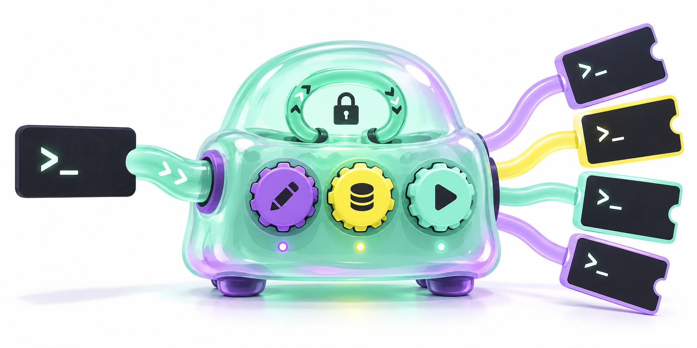

<div align="center">

🇺🇸 [English](README.md) | 🇨🇳 [中文](README.zh.md)

<h1>AirJelly-CLI</h1>

  



</div>

## 引言

AirJelly CLI 将本地 AirJelly 1.x 公开接口封装为命令行工具与标准输入输出 MCP 服务器。覆盖在 AirJelly 1.0.13 中观察到的 43 个方法，动态发现回环端口与凭据，并分别控制读取、写入、模型费用和执行权限。

本仓库包含从 Desktop Memory Bridge 拆出的 AirJelly 适配器。独立的审定日报检索器与 Codex 回忆技能位于 [Desktop-Memory-CLI](https://github.com/JunkaiWang-TheoPhy/Desktop-Memory-CLI)。Screenpipe 沿用已有外部 API/MCP，本仓库不附带其录制器或替代 CLI。

## 组成

| 组件 | 接口 | 用途 |
|---|---|---|
| `airjelly-cli` | Python 包 | 仅用标准库访问带认证的本地公开接口 |
| `airjelly` | CLI | 事件、任务、调度、记忆、人物、用量、提醒和录制控制 |
| `airjelly mcp` | 标准输入输出 MCP | 43 个具备参数结构的 `airjelly_<原生方法名>` 工具和元数据资源 |

真实调用需要 Python 3.11+ 和运行中的本地 AirJelly。工具发现与预演可在应用离线时使用。事件日期简写使用 **Asia/Shanghai**。

## 快速开始

```sh
git clone https://github.com/JunkaiWang-TheoPhy/AirJelly-CLI.git
cd AirJelly-CLI
python3 -m venv .venv
.venv/bin/python -m pip install .
.venv/bin/airjelly methods
.venv/bin/airjelly doctor
.venv/bin/airjelly events list --date yesterday --limit 20 --fields id,title,app_name,start_time
.venv/bin/airjelly recording status
```

也可通过 `call` 和 JSON 参数调用原生方法：

```sh
.venv/bin/airjelly call getDailyAppUsage --params '{"date":"2000-01-01"}'
.venv/bin/airjelly --policy examples/airjelly/read-only.json mcp
```

应用运行描述文件保持私有，无需将凭据复制进 MCP 配置。仓库不分发个人历史、录制媒体或数据库导出。

从原合并仓库升级时，请使用全新克隆与虚拟环境。旧 `desktop-memory-bridge` 与 `airjelly-cli` 是不同发行包，安装新包不会自动卸载旧包；干净构建也可避免带入合并版本遗留产物。

## Codex 接入

使用已安装命令与权限文件的绝对路径注册服务器：

```sh
codex mcp add airjelly-local -- /absolute/path/to/AirJelly-CLI/.venv/bin/airjelly --policy /absolute/path/to/AirJelly-CLI/examples/airjelly/read-only.json mcp
```

历史查询使用只读配置。MCP 随父客户端连接运行，标准输入关闭后退出，不创建监听端口或常驻服务。按需检索已审定日报时，另行安装 [Desktop-Memory-CLI](https://github.com/JunkaiWang-TheoPhy/Desktop-Memory-CLI)。

## 验证

```sh
.venv/bin/python -m unittest discover -s tests -v
```

适配器有 96 项离线测试，覆盖全部 43 个方法映射、认证、权限边界、命令解析、输出控制及 MCP 协议。此前本地验收对 AirJelly 1.0.13 执行了有范围的读取。真实写入、模型费用及自动执行属于独立验证范围。

详见[操作说明](docs/airjelly.zh.md)、[方法合同](docs/airjelly-methods.md)及[验收边界](docs/airjelly-verification.md)。

## 权限与兼容边界

默认允许没有已知模型费用的读取。写入、模型费用、即时或未来执行各需单独授权。工具目录可见不等于有权调用。输出分页仅覆盖后端已返回批次，不能据此声称读完全部历史或全天录制完整。

本项目为独立编写的互操作工具，并非 AirJelly 官方插件，不分发应用，也不绕过许可检查。已观察的合同为 AirJelly 1.0.13/Public API 1，其他版本兼容性尚未核实。

## 许可证

采用 [Apache License 2.0](LICENSE)，归属与第三方应用边界见 [NOTICE](NOTICE)。仓库横幅为生成插画，不是活动记录证据。
